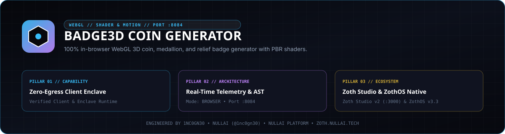

<p align="center">
  
</p>

# Badge3D Coin Generator

Parametric 3D coin, medallion, and relief mesh generator written in pure Python standard library with a Three.js WebGL workstation, built-in FDM G-code slicer, cylindrical rim milling and cryptographic security stamp engine, and JSON-RPC 2.0 MCP server.

- **Version**: `2.5.0`
- **Local Workstation Port**: `127.0.0.1:8084`
- **Zoth Studio Dossier**: [https://zoth.nullai.tech/tools/badge3d-coin-generator](https://zoth.nullai.tech/tools/badge3d-coin-generator)
- **Author**: [1nc0gn30](https://1nc0gn30.si) (`@1nc0gn30`) · [NullAI](https://nullai.tech)

## Overview

`badge3d-coin-generator` synthesizes watertight 2-manifold triangle meshes for commemorative medallions, challenge coins, bullion proofs, and hex/octagon badges without external CAD or C++ runtime dependencies. It computes exact mesh volume (`mm³` / `cm³`), precious-metal casting weights (24k Gold, 18k Gold, Sterling Silver, C932 Bronze, Grade-5 Titanium, Platinum), and exports print-ready Binary STL, ASCII STL, Wavefront OBJ/MTL, glTF 2.0 / GLB, and RepRap/Marlin G-code.

Core capabilities:
- **Parametric Relief & SVG Heightmap Engine**: 10 procedural relief generators (`wreath`, `star`, `cross`, `sunburst`, `hex_grid`, `shield`, `roman_head`, `skull`, `concentric`, `smooth`) plus SVG path rasterization (`SVGRasterizer`) for custom obverse/reverse displacement maps.
- **Cylindrical Edge Milling & Security Stamps**: Sinusoidal, trapezoidal, and square-notch reeding, segmented reeding sectors, cylindrical rim text inscriptions (`incuse` or `raised`), and SHA-256 hash-derived anti-counterfeiting groove patterns.
- **Pure-Python Slicer Engine**: Layer plane intersection, rectilinear/grid/concentric/triangle infill toolpaths, overhang printability analysis, and filament mass estimation (`PLA`, `PETG`, `ABS`, `Resin`).
- **Dual Interface**: Browser-based Three.js WebGL workstation (`127.0.0.1:8084`) and stdio MCP server with 9 registered tools.

## Architecture

```text
badge3d-coin-generator/
├── server.py                             # Standalone server launcher (127.0.0.1:8084)
├── bin/badge3d.js                        # Unified Node/ZothOS CLI & desktop wrapper
├── src/badge3d_coin_generator/
│   ├── __init__.py                       # CoinGenerator API & 5 standard coin presets
│   ├── mesh_engine.py                    # Watertight 2-manifold radial & Cartesian mesh builder
│   ├── svg_rasterizer.py                 # SVG path parser & bilinear heightmap synthesizer
│   ├── edge_milling.py                   # Rim reeding, inscriptions & SHA-256 groove stamps
│   ├── exporters.py                      # Binary/ASCII STL, OBJ/MTL, glTF 2.0 & GLB writers
│   ├── slicer_engine.py                  # Layer slicer, infill generator & G-code compiler
│   ├── ui_server.py                      # ThreadingHTTPServer REST API (:8084)
│   ├── mcp_server.py                     # MCP 2024-11-05 stdio JSON-RPC 2.0 server (9 tools)
│   └── cli.py                            # Multi-subcommand CLI entry point
├── public/                               # Three.js WebGL interactive coin studio
└── tests/                                # Pytest unit & HTTP/MCP integration suite
```

## Quickstart

Clone the repository, install in editable mode, and start the local workstation on `127.0.0.1:8084`:

```bash
git clone https://github.com/1nc0gn30/badge3d-coin-generator.git
cd badge3d-coin-generator
python3 -m pip install -e .

# Start the WebGL Studio & REST API server on 127.0.0.1:8084
python3 server.py --host 127.0.0.1 --port 8084
```

Open `http://127.0.0.1:8084` in a browser or inspect `/api/health`:

```bash
curl -s http://127.0.0.1:8084/api/health
```

## CLI & MCP Usage

### CLI Subcommands

 Installed scripts `badge3d` and `badge3d-coin-generator` (and ZothOS v3.4.0 `/usr/local/bin/badge3d`) expose:

```bash
# Show CLI help or JSON service status
badge3d-coin-generator --help
badge3d-coin-generator --status --json

# List coin presets as JSON
badge3d-coin-generator presets --json

# Generate a watertight Binary STL with rim inscription and SHA-256 security grooves
badge3d-coin-generator generate \
  --preset commemorative_gold \
  --edge-inscription "NULLAI SOVEREIGN MINT" \
  --security-stamp "SERIAL-2026-001" \
  -o gold_medallion.stl

# Export Wavefront OBJ + MTL
badge3d-coin-generator generate -r 20.0 -t 3.2 --pattern hex_grid -f obj -o hex_coin.obj

# Slice a coin directly to Marlin/RepRap G-code
badge3d-coin-generator slice --preset challenge_coin --layer-height 0.16 --infill-density 0.25 --filament pla -o coin.gcode --json

# Inspect cylindrical edge milling & security stamp checksum
badge3d-coin-generator edge --inscription "LIBERTY" --stamp "MINT-SEED-42" --json

# Launch the HTTP server on 127.0.0.1:8084
badge3d-coin-generator serve --host 127.0.0.1 --port 8084 --no-browser

# Run toolchain diagnostics & self-verification
badge3d-coin-generator diagnostics
badge3d-coin-generator test
```

### REST API Endpoints (`127.0.0.1:8084`)

| Method | Endpoint | Description |
| :--- | :--- | :--- |
| `GET` | `/health`, `/api/health` | Service health and version (`2.5.0`) |
| `GET` | `/api/presets` | Studio preset catalog and dimensions |
| `GET` | `/api/stats` | Query volume (`cm³`/`mm³`), metal casting masses, and slicing estimates |
| `GET/POST` | `/api/slice-gcode` | Slice coin geometry to G-code layers or downloadable `.gcode` |
| `POST` | `/api/generate` | Generate watertight 3D mesh and physical topology statistics |
| `POST` | `/api/export-stl` | Stream downloadable IEEE-754 little-endian Binary STL |
| `POST` | `/api/export-obj` | Stream downloadable Wavefront OBJ mesh |
| `POST` | `/api/edge/profile` | Compute compound rim reeding, inscription, and stamp summary |
| `POST` | `/api/edge/crypto-stamp` | Derive deterministic SHA-256 rim tooth depths and parity checksum |
| `POST` | `/api/edge/inscribe` | Evaluate cylindrical coordinate text unwrap metrics |

### MCP Server (`stdio`)

Launch over `stdio` for Claude Desktop, Cursor, Windsurf, or ZothOS agents:

```bash
badge3d-coin-generator mcp
```

Registered MCP tools (9):
- `coin_generate` — Generate 3D coin mesh topology, watertight status, volume, and precious-metal mass table.
- `coin_export_stl` — Export Binary or ASCII STL with FDM/SLA printability checks.
- `coin_export_obj` — Export Wavefront `.obj` and `.mtl` files.
- `coin_presets` — Inspect the preset catalog (`commemorative_gold`, `cyberpunk_hex`, `antique_roman`, `military_challenge`, `sovereign_silver`).
- `coin_slice_gcode` — Slice coin mesh into G-code layers with overhang analysis.
- `coin_generate_edge_profile` — Synthesize compound rim reeding and inscription specifications.
- `coin_stamp_crypto_hash` — Compute SHA-256 anti-counterfeiting groove depths and checksum.
- `coin_inscribe_edge_text` — Compute cylindrical rim text pitch and coordinates.
- `coin_diagnostics` — Run host I/O and geometry throughput benchmarks.

## Testing & Verification

Run the automated test suite and CLI checks locally:

```bash
python3 -m pytest -q
PYTHONPATH=src python3 -m badge3d_coin_generator.cli --status --json
PYTHONPATH=src python3 -m badge3d_coin_generator.cli test
```

## Support

Badge3D Coin Generator is 100% free and open-source with zero paywalls or feature gates. Optional support:
- [Buy Us a Coffee (Stripe)](https://buy.stripe.com/3cIfZg27PdKo2D64Ocfw40X)

## License

Released under the [MIT License](LICENSE). Copyright (c) 2026 1nc0gn30 · NullAI ([https://nullai.tech](https://nullai.tech)).
